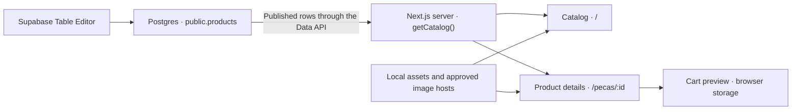

# Desapego da Sah

Desapego da Sah is Samara Viau's resale storefront for clothing and accessories from her personal wardrobe. She can share the catalog when a new drop is ready, and shoppers can browse on their phones, inspect each item, and put several pieces in their cart. Most listings represent a single piece. The product model also supports multiple units without displaying the exact quantity to shoppers.

The storefront is written in Brazilian Portuguese and displays prices in Brazilian reais (BRL). The current release supports a live catalog and a browser-based cart. Checkout, shipping quotes, payments, and order management are planned.

## What works today

- **Catalog** with product photos, names, prices, sizes, and availability. Shoppers can search and filter by category, size, and availability, and sort by price.
- **Product details** with a shareable URL, condition and description, and a photo gallery. A listing with one photo offers an enlarged view of that photo.
- **Cart preview** with item removal and a subtotal. The browser stores product IDs and resolves them against the current catalog. Each product can appear once per cart. Sold-out pieces remain browsable, with purchase actions disabled.
- **Product publishing** through Supabase Table Editor. Drafts stay out of the storefront and published items with zero stock appear as sold out.
- **Design system** preview at `/design-system`, covering the storefront palette, type, and interface components.

**Buy now** currently opens a single-item summary. Cart actions do not create an order or reserve stock.

## Technology stack

| Area | Technology |
| --- | --- |
| Application | Next.js 16 App Router, React 19, TypeScript 5 |
| UI | Tailwind CSS 4, shadcn/ui components, Radix UI dialogs, and Lucide icons |
| Product data | Supabase Postgres and the Supabase Data API |
| Images | Next.js Image, local assets, and approved public image URLs |
| Fonts | Cormorant Garamond, DM Sans, and Castoro, served locally through `next/font` |
| Tooling | npm, ESLint, Prettier, and TypeScript |

## Architecture



- **Server rendering.** The catalog and product detail routes read from [`lib/catalog-source.ts`](lib/catalog-source.ts). It queries the Data API with the publishable key, reads rows in batches, and maps them to the shared product model. Configured catalog requests use `cache: "no-store"`, so edits can appear on the next server render without a new deployment.
- **Browser interactions.** Client components handle filters, sorting, gallery navigation, sharing, and the cart. The cart stores product IDs in `localStorage`. The product details route supplies the current published catalog so the cart can resolve names, prices, and availability.
- **Access control.** The storefront uses the publishable key. PostgreSQL row-level security limits anonymous reads to published products. Column grants expose the generated `sold` flag while keeping exact stock and editing operations private.
- **Image delivery.** Product rows store URLs for the main photo and gallery. `next/image` serves appropriately sized variants. Remote sources must match the host and path rules in [`next.config.ts`](next.config.ts).

### Routes and directories

| Path | Responsibility |
| --- | --- |
| `app/page.tsx` | Storefront at `/` |
| `app/pecas/[id]/page.tsx` | Product detail route. Missing or unpublished IDs return a 404 when Supabase is configured. |
| `app/design-system/page.tsx` | Visual reference at `/design-system` |
| `app/globals.css` | Design tokens and shared styles |
| `components/catalog/` | Catalog layout, filters, and product cards |
| `components/store/` | Shared storefront header and footer, gallery, cart, and sharing |
| `components/ui/` | Shared shadcn/ui components |
| `lib/catalog.ts` | Product type, BRL formatting, and demo fixtures |
| `lib/catalog-source.ts` | Server-side Supabase catalog reader |
| `public/` | Local images, fonts, and font licenses |

## Run locally

Use **Node.js 20.9 or newer** and npm. From the repository root:

```bash
npm ci
npm run dev
```

Open [http://localhost:3000](http://localhost:3000). Leave both Supabase variables unset to use the demo catalog. Demo products and photos are marked as illustrative in the storefront.

### Connect a Supabase project

1. Use a Supabase project with the `public.products` table and access rules described below. For a fresh project, run the SQL in the next section through the Supabase SQL Editor.
2. Copy [`.env.example`](.env.example) to `.env.local`. Set both variables and restart the development server if it is running.

   ```dotenv
   SUPABASE_URL=https://your-project-ref.supabase.co
   SUPABASE_PUBLISHABLE_KEY=sb_publishable_your_key
   ```

   Use the project's API URL and **publishable** key from the Supabase dashboard. Keep environment files with real values out of version control.

3. Add a product in **Table Editor → products** and set `is_published` to `true` after reviewing it. An empty catalog is expected until at least one row is published.
4. If product photos are hosted in a different Supabase project or image bucket, add the corresponding public URL pattern to `next.config.ts`.

### Create the catalog table in a fresh project

<details>
<summary>SQL for the products table and storefront read policy</summary>

```sql
begin;

create table public.products (
  id uuid primary key default gen_random_uuid(),
  name text not null check (btrim(name) <> ''),
  category text not null check (category in ('Roupas', 'Bolsas', 'Calçados', 'Acessórios')),
  brand text,
  size text not null check (btrim(size) <> ''),
  price_cents integer not null check (price_cents > 0),
  image_url text not null check (btrim(image_url) <> ''),
  photo_urls text[] not null default '{}',
  condition text not null check (btrim(condition) <> ''),
  description text not null check (btrim(description) <> ''),
  stock integer not null default 1 check (stock >= 0),
  sold boolean generated always as (stock = 0) stored,
  is_published boolean not null default false,
  created_at timestamptz not null default now()
);

alter table public.products enable row level security;
revoke all on public.products from public, anon, authenticated;
grant select (
  id, name, category, brand, size, price_cents, image_url, photo_urls,
  condition, description, sold, created_at
) on public.products to anon, authenticated;

create policy "Read published products"
  on public.products for select to anon, authenticated
  using (is_published);

create index products_published_order_idx
  on public.products (created_at desc, id)
  where is_published;

commit;
```

</details>

### Publish a product

1. Add the product name, category, size, description, and condition. Include measurements and visible wear when relevant.
2. Enter the price as an integer in centavos. For example, enter `12990` for R$ 129,90. Use `stock = 1` for a one-off piece.
3. Set `image_url` to the main photo and add any extra photo URLs to `photo_urls` in gallery order. Use a local path under `public/` such as `/images/jacket.jpg`, or an approved public URL.
4. Set `is_published = true` to show the listing. Set it to `false` to take it out of the catalog. The database derives `sold` from stock.

The [product entry guide](docs/cadastro-de-produtos.md) has worked examples for local photos and Supabase Storage. See the [design notes](docs/design-system.md) for typography, colors, and asset references. Both guides are in Portuguese.

## Commands

| Command | Purpose |
| --- | --- |
| `npm run dev` | Start the Next.js development server |
| `npm run lint` | Run ESLint |
| `npm run typecheck` | Check TypeScript types |
| `npm run format` | Format TypeScript and TSX files in place |
| `npm run build` | Compile a production build |
| `npm start` | Serve the compiled production build |

For deployment, set both Supabase variables in the hosting environment and use a host that supports the Next.js server runtime. The storefront currently asks search engines to skip indexing through the root metadata in [`app/layout.tsx`](app/layout.tsx). Review that setting when the site is ready to be indexed.

## Planned functionality

- **Guest checkout and inventory reservation.** Revalidate prices and availability on the server and reserve stock while payment is pending. Release expired reservations so that unique pieces can return to the catalog.
- **Payments.** Evaluate AbacatePay for Pix and credit card payments, including installments. Confirm payment on the server before recording a purchase.
- **Shipping.** Integrate Melhor Envio for shipping quotes by postal code. Samara plans to pack and post orders manually and register tracking codes.
- **Order confirmation and tracking.** Send a confirmation email with a secure link so customers can follow a purchase without an account.
- **Order administration.** Provide a restricted dashboard for paid and pending orders, carriers, and tracking codes. Product entry remains in Supabase Table Editor, and customer support is planned through WhatsApp Business.
