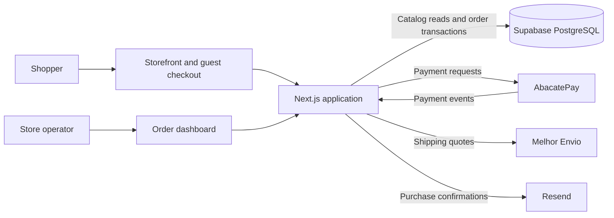

# Desapego da Sah

**Secondhand fashion e-commerce built for Samara Viau by Gabriel Lennon**

Desapego da Sah is the online store where Brazilian influencer Samara Viau sells pre-owned clothing and accessories from her personal wardrobe. I built the application for her store, from browsing a new drop to checking out and tracking a delivery. The storefront is designed for mobile shoppers, with a Brazilian Portuguese interface, prices in BRL, and checkout without an account.

**Samara Viau** · [Instagram](https://www.instagram.com/samaraviau/) · [TikTok](https://www.tiktok.com/@eusamaraviau)

## Product

| Experience       | Capabilities                                                                                                     |
| ---------------- | ---------------------------------------------------------------------------------------------------------------- |
| Storefront       | Browse drops, search and filter pieces, and inspect photos, sizing, condition, and availability.                 |
| Guest checkout   | Purchase a single item or a full cart, compare shipping options by postal code, and pay via Pix or credit card.  |
| Order tracking   | Receive confirmation by email, follow fulfillment milestones, and copy the carrier tracking code when available. |
| Store operations | Review payment and order details, manage tracking information, and record delivery in a restricted dashboard.    |

## Architecture

The application uses a **modular monolith** built with the Next.js App Router. The storefront, checkout, post-purchase experience, and dashboard share a single deployment and design system. Commerce modules define the boundaries for catalog reads, checkout orchestration, and order management. PostgreSQL is the source of truth for inventory and order state.



- **Rendering boundary.** React Server Components fetch the published catalog and render product pages. Client components handle interactive filters, galleries, cart state, and checkout forms. The cart persists product IDs in browser storage and resolves them against the current catalog.
- **Data access boundary.** Public catalog queries use a paginated read model with row-level access to published listings. Privileged order reads and writes run on the server. PostgreSQL functions encapsulate inventory reservation and payment updates.
- **Integration boundary.** Route handlers coordinate checkout requests and payment webhooks. Shipping quotes, payment processing, and transactional email are delegated to their respective providers. The application receives a token from the card provider and keeps raw card data out of its storage.

## Engineering decisions

| Concern              | Implementation                                                                                                                                                                                                                                                     |
| -------------------- | ------------------------------------------------------------------------------------------------------------------------------------------------------------------------------------------------------------------------------------------------------------------ |
| Inventory contention | Reserve inventory atomically with order creation and item snapshots. This keeps two concurrent checkout attempts from claiming the same last unit.                                                                                                                 |
| Pricing integrity    | Verify the shipping quote server-side and revalidate product prices at reservation time. Store monetary amounts as integer centavos for payment calculations.                                                                                                      |
| Payment consistency  | Correlate provider charges with the order and validate the amount before applying payment updates. Handle asynchronous provider events and reconcile expired pending Pix payments. An ambiguous provider response keeps the reservation in place for confirmation. |
| Retry behavior       | Reuse an existing order on repeated checkout submissions. Send confirmation emails with an order-scoped idempotency key so retries within the email provider's deduplication window do not send duplicate confirmations.                                           |
| Order history        | Persist item details, prices, and the selected shipping option as purchase-time snapshots so catalog edits leave previous orders intact.                                                                                                                           |
| Access control       | Separate public catalog permissions, guest order access, and authenticated administrative operations. Keep integration credentials on the server and store administrator passwords as hashes.                                                                      |
| Fulfillment          | Keep label purchase and dispatch manual. Recording shipment or delivery in the dashboard updates the customer-facing timeline on the next read.                                                                                                                    |

## Technology stack

| Layer                 | Tools                                         |
| --------------------- | --------------------------------------------- |
| Application           | Next.js 16, React 19, TypeScript              |
| UI                    | Tailwind CSS 4, shadcn/ui, Radix UI, Lucide   |
| Data                  | Supabase PostgreSQL and the Supabase Data API |
| Payments and shipping | AbacatePay, Melhor Envio, ViaCEP              |
| Transactional email   | Resend                                        |
| Tooling               | npm, ESLint, Prettier                         |

The interface combines an Espresso, Peony, and Off-white palette with locally served Cormorant Garamond and DM Sans. The `/design-system` page documents the visual primitives used across the storefront and dashboard.

## Repository map

| Path                    | Responsibility                                                        |
| ----------------------- | --------------------------------------------------------------------- |
| `app/`                  | App Router pages, server actions, and HTTP handlers                   |
| `components/`           | Domain-specific interfaces and shared UI primitives                   |
| `lib/catalog-source.ts` | Paginated catalog queries and mapping to the storefront product model |
| `lib/checkout/`         | Checkout validation, provider integration, and payment state          |
| `lib/orders/`           | Guest order access and confirmation delivery                          |
| `app/globals.css`       | Design tokens and shared styles                                       |

## Run the storefront demo

Use Node.js 20.9 or later and npm.

```bash
npm ci
npm run dev
```

Open [http://localhost:3000](http://localhost:3000). With Supabase unconfigured, the storefront and product pages run with sample data and require no provider accounts.

| Command             | Purpose                |
| ------------------- | ---------------------- |
| `npm run lint`      | Run ESLint             |
| `npm run typecheck` | Check TypeScript types |
| `npm run build`     | Build for production   |
